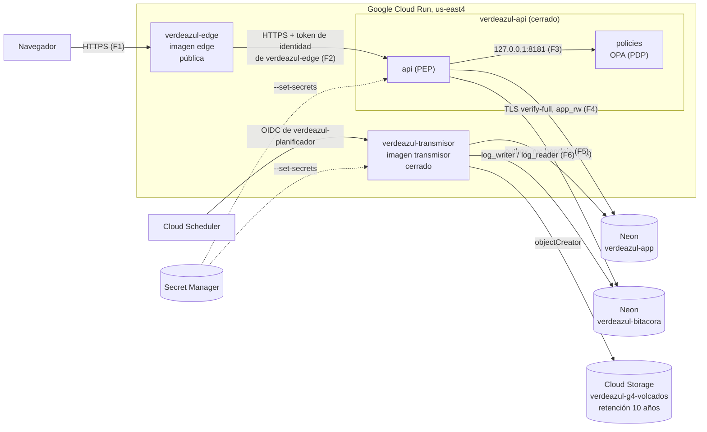

# Informe de implementación: material y guía

Este archivo junta **todo lo que va en el informe** de la Parte 2 (§5.1 del
enunciado, 6 a 10 páginas), sección por sección, con lo que ya está construido
y dónde comprobarlo. Es la materia prima para el documento en LaTeX: se puede
copiar casi tal cual y recortar.

Cada sección dice **quién la completa** si falta algo. Lo marcado con ⏳ todavía
no existe en `develop` al 13 de noviembre.

---

## 0. Portada y datos de entrega

| | |
|---|---|
| Sistema | https://verdeazul-edge-igwgmkeipa-uk.a.run.app |
| Repositorio | https://github.com/CarlosCL13/CE1115-P2-Grupo4-Verdeazul |
| Proyecto de Google Cloud | `verdeazul-g4`, región `us-east4` |
| Neon | `verdeazul-app` (principal) y `verdeazul-bitacora` (bitácora), AWS `us-east-1` |

**Credenciales de prueba (entregable 1).** Se entregan al profesor por un canal
aparte o en el PDF, **nunca en el repositorio**. Hay once cuentas: `dg`, `dc`,
`pa`, `tc1`, `tc2`, `vf1`, `vf2`, `ae`, `df1`, `df2`, `ta`. Las de `dg`, `dc`,
`pa`, `vf1` y `vf2` piden además un código TOTP: se entrega su línea
`otpauth://` o el QR. Si el profesor prefiere no instalar una aplicación
autenticadora, se puede mostrar en la presentación desde un celular del grupo.

---

## 1. Arquitectura desplegada

Lo que corre de verdad, con sus imágenes y cómo se comunican:

| Componente (P1) | Aquí | Imagen | Acceso |
|---|---|---|---|
| Proxy inverso / interfaz | `services/edge` + TLS de Cloud Run | `edge` | Público, el único |
| Backend (PEP) | `services/api` | `api` | Solo con credencial de Google: la del borde |
| Motor de políticas (PDP) | `services/policies`, contenedor adjunto | `policies` | Solo `127.0.0.1` dentro del servicio del backend |
| Transmisor y trabajos programados | `services/transmisor` | `transmisor` | Solo Cloud Scheduler. Una instancia, una petición a la vez |
| Base de datos (PIP) | Neon `verdeazul-app` | — | Roles de mínimo privilegio |
| Bitácora | Neon `verdeazul-bitacora`, **otro proyecto** | — | El transmisor solo inserta; la API solo lee |
| Gestor de secretos | Secret Manager (D-03) | — | Cada cuenta de servicio lee solo los suyos |
| Copia de retención | Cloud Storage `verdeazul-g4-volcados` | — | El transmisor solo crea objetos |

**Fronteras de confianza de P1, implementadas:**

| | Entre | Cómo se hace cumplir |
|---|---|---|
| F1 | Navegador → borde | HTTPS de Cloud Run; cookie `__Host-` `HttpOnly`, `Secure`, `SameSite=Strict`; CSRF por token y por origen; CSP |
| F2 | Borde → backend | El backend no acepta invocaciones anónimas (`--no-allow-unauthenticated`); el borde se identifica con la cuenta `verdeazul-edge`, cuyo único permiso es invocarlo |
| F3 | Backend → motor | Contenedor adjunto, mismo espacio de red, solo `127.0.0.1`. Si el motor no responde, se niega todo |
| F4 | Backend → base | TLS `verify-full`; rol `app_rw` sin dueño de tablas, permisos de UPDATE por columna |
| F5 | Operación → bandeja | El evento se escribe en la misma transacción que la operación; `app_rw` no puede modificarlo después (migración 012) |
| F6 | Bandeja → bitácora | Otra instancia de Neon; `log_writer` solo INSERT, `log_reader` solo SELECT; cadena HMAC; copia semanal a Cloud Storage |

**Flujo de una petición:** el borde recibe la cookie, llama al backend con el
token de sesión en una cabecera y su identidad de Google en otra. El backend
carga la sesión (y las zonas vigentes) en cada petición, carga el objeto real
de la base, le pregunta al motor con el sujeto, la operación y los atributos, y
solo si el motor dice que sí ejecuta. Si dice que no, anota `ACCESO_DENEGADO`
en la bandeja y responde 403. Cada 30 minutos el transmisor copia la bandeja a
la bitácora y encadena cada evento con HMAC.

---

## 2. Controles implementados (§2.3)

| Control | Dónde está | Cómo se verifica |
|---|---|---|
| **2.3.1 Contraseñas con hash lento** | `services/api/app/auth/contrasenas.py`: Argon2id (m = 19 MiB, t = 2, p = 1), sal por contraseña, lista de contraseñas prohibidas (`prohibidas.txt`), mínimo de 15 caracteres | `tests/identidad/test_unitarias.py`: el hash empieza con `$argon2id$v=19$m=19456,t=2,p=1$` y la sal cambia en cada hash. Captura: la columna `hash_argon2` en Neon |
| **2.3.2 Control de acceso en el servidor** | Cada endpoint llama a `autorizar()` (`services/api/app/auth/dependencias.py`) antes de tocar la base; el motor en Rego (`services/policies/rego/`) decide; deniega por omisión y si el motor cae | 977 pruebas de la matriz contra OPA real (`tests/matriz`) y pruebas por endpoint en `tests/` (abajo, §6). Captura: `pa` escribiendo a mano `/bitacora/exportar` → «Acceso denegado» |
| **2.3.3 Secretos fuera del código** | Secret Manager, inyectados con `--set-secrets` (`.github/workflows/desplegar.yml`); `.env` en `.gitignore`; despliegue con federación de identidad, sin archivo de credenciales | Job «Buscar credenciales versionadas» (gitleaks sobre todo el historial) en cada pull request. Captura: Secret Manager |
| **2.3.4 TLS en todo el tráfico** | Cloud Run solo sirve HTTPS en `*.run.app`; Neon con `sslmode=verify-full` (el código rechaza otra cosa, `config.py`); borde → backend por HTTPS | Captura del candado y del certificado en el navegador; `migrar.py` y `config.py` fallan si la cadena no pide `verify-full`. ⏳ Falta la cabecera HSTS (pendientes) |
| **2.3.5 Validación de entradas** | Consultas parametrizadas en todos los módulos (`%s` de psycopg); los filtros tienen forma cerrada (patrones en `Query`, modelos de Pydantic); los fragmentos de SQL son fijos | Pruebas de 422 con entradas como `X' OR '1'='1` y `1; DROP TABLE eventos` (`tests/bitacora`), y de 422 en los modelos de enmiendas y asignaciones |
| **2.3.6 Firma digital de certificados** | ⏳ O5 (Meibel): Ed25519 con la llave de Secret Manager (`llave-firma-certificados`), clave pública dentro del documento (D-10) | ⏳ Emitir, verificar y verificar uno alterado que falle |

Controles de P1 que también se implementaron, para la sección o un anexo:

- **Segundo factor TOTP** para DG, DC, PA y verificadores (D-13), y
  **reautenticación** antes de aprobar mediciones y enmiendas, cerrar
  enmiendas, abrir y cerrar períodos, cambiar cuentas y asignar zonas.
- **Bloqueo por intentos** (RC-01): espera creciente desde el quinto intento y
  bloqueo de 30 minutos al décimo.
- **Datos personales cifrados** (LG-05): cédula, teléfono y secreto TOTP con
  AES-256-GCM; búsqueda por cédula con HMAC con llave.
- **Separación de deberes dinámica**: C3 (nadie aprueba lo que midió), C4, C5
  (tres personas por enmienda) y C10 (aprobación previa de DG).
- **Revocar el mismo día** (CU-11): las zonas se leen en cada petición, así que
  revocar una asignación quita el acceso en el siguiente clic.
- **Contenedores sin root**: `USER 10001:10001` en los Dockerfile de api, edge
  y transmisor. ⏳ Confirmar el de OPA (pendientes).
- **Imágenes con versión**: etiqueta = los siete primeros caracteres del
  commit; nunca `latest`.

---

## 3. Gestión de secretos

| Secreto | Qué es | Lo lee |
|---|---|---|
| `verdeazul-db-url` | Cadena de `app_rw` en la base principal | backend |
| `verdeazul-bitacora-lectura-url` | Cadena de `log_reader` en la bitácora | backend y transmisor (`cadena`, `volcado`) |
| `llave-busqueda-cedula` | HMAC para buscar por cédula | backend |
| `llave-cifrado-datos` | AES-256-GCM de cédula, teléfono y secreto TOTP | backend |
| `llave-firma-certificados` | Llave privada Ed25519 | backend |
| `verdeazul-outbox-url` | Cadena de `outbox_rw` | transmisor |
| `verdeazul-bitacora-escritura-url` | Cadena de `log_writer` | transmisor |
| `llave-cadena-bitacora` | HMAC de la cadena de la bitácora | transmisor |

**Cómo llegan al contenedor.** `gcloud run deploy --set-secrets=VAR=secreto:latest`:
la revisión de Cloud Run guarda la referencia, no el valor, y lo inyecta como
variable de entorno al arrancar. `config.py` de cada servicio los envuelve en
una clase `Secreto` que no se imprime en registros, y en la nube el contenedor
no arranca si falta uno (Cloud Run sigue con la revisión anterior).

**Quién puede leer cuál.** Cada servicio corre con su propia cuenta de servicio
(`verdeazul-api`, `verdeazul-edge`, `verdeazul-transmisor`) con
`roles/secretmanager.secretAccessor` solo sobre sus secretos. El borde no lee
ninguno. Sin cuentas propias, Cloud Run usaría la de Compute, que es Editor de
todo el proyecto.

**El despliegue tampoco tiene llave.** GitHub Actions se autentica con
federación de identidad (Workload Identity Federation): no existe un JSON de
cuenta de servicio, ni en el repositorio ni en los secretos de GitHub.

**En local**, las mismas cadenas van en un `.env` ignorado por git, copiadas de
Secret Manager. Lo que no es secreto (`VOLCADO_DEPOSITO`, `APP_VERSION`) va como
variable de entorno normal.

**Riesgos que quedan** (D-03): las credenciales de base de datos son estáticas
(OpenBao las rotaba solo) y las llaves de HMAC y cifrado están en la memoria del
proceso, no en un motor que nunca las suelte.

---

## 4. Seguridad heredada de la plataforma

### Neon

| | |
|---|---|
| **Lo que protege por defecto** | Cifrado en reposo del almacenamiento; TLS obligatorio en las conexiones; aislamiento entre proyectos (cómputo y almacenamiento propios); autenticación por contraseña (SCRAM); restauración a cualquier punto de las **últimas seis horas** en el plan gratuito; respaldo del almacenamiento a cargo del proveedor |
| **Lo que configuramos** | `sslmode=verify-full` (verifica el certificado y el nombre del servidor, no solo cifra), impuesto en el código; **dos proyectos** en vez de dos ramas, para que la bitácora sea otra instancia que la aplicación no alcanza (F6); **cinco roles** de mínimo privilegio: `app_migrate` (dueño del esquema, solo migraciones), `app_rw` (la API: sin DELETE, UPDATE por columna, no puede alterar el esquema ni la bandeja), `outbox_rw` (el transmisor: solo la bandeja y la fecha de revocación de O7 y O8), `log_writer` (solo INSERT en la bitácora), `log_reader` (solo SELECT); el dueño `neondb_owner` no lo usa ningún servicio |
| **Por qué y qué se descartó** | Dos ramas de un mismo proyecto comparten credenciales de dueño y cuota: separan entornos, no confianza. Restricción por IP: no está en el plan gratuito, y Cloud Run no tiene IP fija sin un conector de pago (D-08) |
| **Lo que no cubre (nuestro)** | Una consulta mal construida (por eso consultas parametrizadas); un permiso de más (por eso roles por columna); una credencial filtrada (sin restricción por IP, sirve desde cualquier lado hasta que se rote: D-03, D-08); retención de diez años (la ventana es de seis horas: por eso `volcado`, D-07); un administrador de la cuenta de Neon puede borrar los proyectos (RR-02) |

Amenazas de la Parte 1 que la plataforma **no** cubre y se cubrieron en la
aplicación: AI-02 (editar una medición aprobada: UPDATE por columna y
enmiendas), AI-07 (alterar la bitácora: otra instancia, solo INSERT, cadena
HMAC, `cadena` y `volcado`), AE-01 (IDOR: el motor decide con el objeto real),
AE-02 (credenciales robadas: Argon2id, lista prohibida, TOTP, bloqueo).

### Cloud Run (responsabilidad compartida)

| Google | Nosotros |
|---|---|
| La infraestructura, el aislamiento entre contenedores, el certificado y la terminación del TLS, la protección del frente de red, el escalado | El código, las cabeceras de seguridad (CSP y demás, D-04), los permisos IAM (quién invoca a quién), las cuentas de servicio, los secretos y qué servicio es público |

Media página basta: lo que se evalúa es trazar la línea.

---

## 5. Desviaciones respecto al diseño

Están completas en `docs/P2_Desviaciones_respecto_P1.md`, D-01 a D-19, cada una
con qué cambió, por qué y su implicación de seguridad. En el informe va la
tabla resumen de ese archivo y un párrafo de las tres con más peso:

- **D-03 Secret Manager en vez de OpenBao**: credenciales estáticas y llaves en
  el proceso; compensado con mínimo privilegio, otra instancia para la bitácora
  y la copia externa.
- **D-05 Autenticación propia en vez de Keycloak**: sin passkeys; TOTP y
  reautenticación en su lugar.
- **D-07 Continuidad**: seis horas de restauración en Neon; diez años solo para
  la bitácora, con retención sin bloquear.

---

## 6. Cobertura de la matriz

88 celdas (8 roles × 11 objetos); 84 operaciones concedidas, 37 con condición;
884 pares denegados por omisión. **Todas** están probadas a nivel del motor en
`tests/matriz/test_celdas.py` (977 pruebas contra OPA real en cada pull request).
La tabla dice además dónde vive cada permiso y qué prueba lo ejercita de punta a
punta contra PostgreSQL.

| Objeto | Op. | Roles (condición) | Endpoint | Prueba de punta a punta |
|---|---|---|---|---|
| O1 Fincas | L | DG, DC, PA; TC, VF (C1); AE (C7); DF (C8) | `GET /fincas`, `/fincas/{id}` | `tests/certificacion/test_fincas.py` |
| | C, M | PA | `POST /fincas`, `PATCH /fincas/{id}` | idem |
| O2 Períodos | L | DG, DC, TC, VF, DF; AE (C7) | `GET /periodos`, `/periodos/{id}` | `tests/certificacion/test_periodos.py` |
| | Ab | DC | `POST /periodos`, `/periodos/{id}/abrir` (D-17) | idem |
| | Cr | DC | `POST /periodos/{id}/cerrar` | idem |
| O3 Mediciones | L | DG, DC, VF; TC (C1); AE (C7); DF (C8) | `GET /mediciones`, `/mediciones/{id}` | `tests/certificacion/test_mediciones.py` |
| | C | TC (C2, y C1 por D-18); VF (C1 ∧ C2) | `POST /mediciones` | idem |
| | A, D | VF (C3) | `POST /mediciones/{id}/aprobar`, `/devolver` | idem |
| | X | AE (C7) | `GET /mediciones/exportar` | idem |
| O4 Enmiendas | L | DG, DC, VF; TC (C1); AE (C7); DF (C8) | `GET /enmiendas`, `/enmiendas/{id}` | `tests/enmiendas/test_enmiendas.py` |
| | C | TC (C11) | `POST /enmiendas` | idem |
| | A, D | VF (C4) | `POST /enmiendas/{id}/aprobar`, `/devolver` | idem |
| | Cr | DC (C5) | `POST /enmiendas/{id}/cerrar` | idem |
| | X | AE (C7) | `GET /enmiendas/exportar` | idem |
| O5 Certificados | L | DG, DC, VF; AE (C7); DF (C8); TA (C9) | ⏳ `GET /certificados`, `/certificados/{id}` | ⏳ |
| | Em | VF (C6) | ⏳ `POST /certificados/{id}/emitir` | ⏳ |
| | An | DC | ⏳ `POST /certificados/{id}/anular` | ⏳ |
| | X | AE (C7) | ⏳ `GET /certificados/exportar` | ⏳ |
| O6 Datos personales | L | DG, PA; DF (C8) | `GET /personas`, `/personas/{id}` | `tests/identidad/test_flujos.py` |
| | C, M | PA | `POST /personas`, `PATCH /personas/{id}` | idem |
| O7 Consentimientos | L | DG, PA; DF (C8) | ⏳ `GET /consentimientos`, `/{id}` | ⏳ |
| | C | PA; DF (C8) | ⏳ `POST /consentimientos` | ⏳ |
| | M | DF (C8) | ⏳ `PATCH /consentimientos/{id}` | ⏳ |
| O8 Asignaciones | L | DG, DC; TC, VF (C1) | `GET /asignaciones`, `/asignaciones/{id}` | `tests/asignaciones/test_asignaciones.py` |
| | C, M | DC | `POST /asignaciones`, `PATCH /asignaciones/{id}` | idem |
| O9 Cuentas | L, C, M | DG (L); PA (C10) | `GET /cuentas`, `POST /cuentas`, `PATCH /cuentas/{id}` + solicitudes | `tests/identidad/test_flujos.py` |
| O10 Credencial propia | M | los ocho roles | `PATCH /credenciales` | idem |
| O11 Bitácora | L | DG, DC, PA; AE (C7) | `GET /bitacora` | `tests/bitacora/test_bitacora.py` |
| | X | DG, DC; AE (C7) | `GET /bitacora/exportar` | idem |

Nadie tiene E (eliminar) sobre nada, y no existe ninguna ruta DELETE. O10 no
tiene L: no existe `GET /credenciales`, a propósito.

**Cómo se comprobó, además de las pruebas:** demostración manual en local contra
Neon de cada objeto de O4, O8 y O11 con las cuentas de prueba (las capturas de
§7), y los intentos denegados vistos en la propia bitácora.

---

## 7. Evidencia: capturas

| # | Captura | Cómo sacarla | Quién |
|---|---|---|---|
| 1 | **Sistema por HTTPS** | La URL pública con el candado y el detalle del certificado | cualquiera |
| 2 | **Secret Manager** | Consola → Secret Manager: la lista de los ocho secretos (sin abrir valores) | Carlos o Adriel |
| 3 | **Dependabot activo** | GitHub → Settings → Code security (Dependabot alerts y version updates encendidos) + la pestaña de PR de Dependabot + PR #24 | Adriel |
| 4 | **Certificado verificado** | ⏳ `/verificar` con un certificado emitido → válido | Meibel |
| 5 | **Certificado alterado que falla** | ⏳ El mismo archivo con un número cambiado → inválido | Meibel |
| 6 | **Intento fallido de un rol** | Con `pa`, escribir `/bitacora/exportar` → «Acceso denegado», y su `ACCESO_DENEGADO` en la bitácora con el motivo | Adriel |
| 7 | Bitácora con las acciones | `dg` → Bitácora, filtro por objeto O4 u O8 | Adriel |
| 8 | Cadena verificada | Bitácora, Sujeto = SISTEMA: `CADENA_VERIFICADA` con 0 rotos | Adriel |
| 9 | Copia que no se puede borrar | Cloud Storage → `verdeazul-g4-volcados` → intentar borrar un objeto → lo impide la retención | Adriel |
| 10 | Separación de deberes | Enmienda cerrada con «pidió tc1 · revisó vf2 · cerró dc» | Adriel |
| 11 | Revocar el mismo día | Dos ventanas: `tc1` ve Palo Verde, DC revoca, `tc1` recarga y ya no | Adriel |
| 12 | CI en verde | Los checks de un PR: matriz, identidad, Rego, imágenes, gitleaks, transmisor | cualquiera |
| 13 | Imágenes versionadas | Artifact Registry → `verdeazul` → etiquetas por commit | Carlos |
| 14 | Contenedor sin root | `USER 10001:10001` en un Dockerfile | cualquiera |
| 15 | Neon | Los dos proyectos y los roles; la cadena con `verify-full` (sin la contraseña) | Carlos o Adriel |

---

## 8. Para la presentación (§6, 15 minutos)

| Lo que hay que mostrar | Con qué |
|---|---|
| HTTPS desde internet | La URL pública, desde una red distinta a la del equipo |
| Cada rol haciendo lo suyo | `tc1` pide una enmienda → `vf2` la aprueba → `dc` la cierra; `dc` asigna una zona |
| Un rol intentando lo que no le toca | `pa` en `/bitacora/exportar`; `tc1` en `/asignaciones` sin zona |
| Emitir, verificar y uno alterado | ⏳ O5 |
| La bitácora con esas acciones | Transmitir a mano (o esperar la corrida) y filtrar por objeto |
| Secretos y Dependabot | Secret Manager y `docs/Dependabot.md` |

Cada integrante tiene que poder explicar una parte que no escribió (§6): antes
del 19 conviene un recorrido de 10 minutos por parte.
